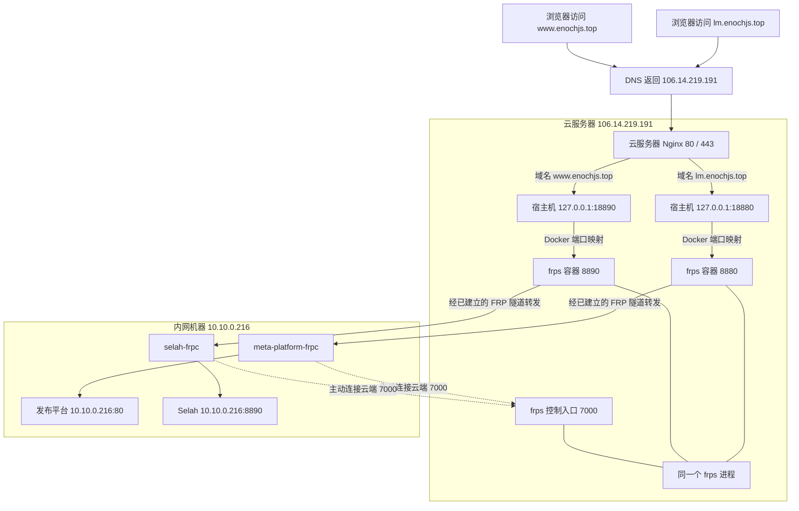

# 一个 frps 如何把多个域名转发给不同 frpc

本文以当前部署为例，解释 `www.enochjs.top` 为什么进入 Selah，而 `lm.enochjs.top` 进入发布平台。配置与访问结果核对日期：2026-11-17。

**当前方案是：多个域名解析到同一个公网 IP，由 Nginx 按域名选择端口，再由同一个 frps 将不同端口的连接交给对应 frpc。**

先记住这四个分工：

| 组件  | 负责什么                                              | 本例                                   |
| ----- | ----------------------------------------------------- | -------------------------------------- |
| DNS   | 根据域名找到公网 IP                                   | 两个域名都指向 `106.14.219.191`        |
| Nginx | 接收网站请求、处理 HTTPS，根据域名选择上游            | `lm` 选 `18880`，`www` 选 `18890`      |
| frps  | 在云服务器上接收客户端注册，把代理端口与隧道关联起来  | `8880` 对应发布平台，`8890` 对应 Selah |
| frpc  | 主动连上 frps，将隧道中的连接转给自己能访问的业务服务 | 分别访问内网 `80` 和 `8890`            |

## 1. 先看完整链路



图中的实线表示业务请求的转发方向，虚线表示 frpc 主动建立控制连接的方向；不是云服务器主动拨通内网 IP。响应沿对应链路返回浏览器。

当前两个 frpc 都在 `10.10.0.216` 上，只是运行在两个独立容器里。它们也可以分别放在两台机器、两个家庭网络或两个机房，只要各自能连接云服务器的 frps，并能访问自己的业务目标。

## 2. 同一个 IP 为什么能对应两个网站

当前 DNS 记录是：

| 域名              | 记录类型 | 记录值           |
| ----------------- | -------- | ---------------- |
| `lm.enochjs.top`  | A        | `106.14.219.191` |
| `www.enochjs.top` | A        | `106.14.219.191` |

DNS 只回答“这个域名的 IP 是什么”，不会决定请求最终进入哪个 frpc，也不会在 A 记录里配置业务端口。

浏览器连接到同一个公网 IP 后，请求里仍然有域名信息。例如 HTTP 请求包含：

```http
GET / HTTP/1.1
Host: lm.enochjs.top
```

另一个网站的请求则带着 `Host: www.enochjs.top`。Nginx 根据请求域名匹配 `server_name`，从而选中不同站点。

HTTPS 还多一步：浏览器通常在 TLS 握手时通过 **SNI** 告诉 Nginx 要访问的域名，Nginx 据此选择证书；解密 HTTP 请求后，再按照站点配置转发。

因此，两站可以共用 IP 和公网 `443` 端口。它们由同一个 Nginx 进程管理多个虚拟主机，并不是两个独立服务争抢监听端口。

## 3. 看懂这些容易混淆的端口

| 所在位置       | 地址或端口         | 用途                                           |
| -------------- | ------------------ | ---------------------------------------------- |
| 云服务器公网   | `80` / `443`       | 浏览器访问 Nginx 的 HTTP / HTTPS 入口          |
| 云服务器公网   | `7000/TCP`         | 两个 frpc 连接同一个 frps 的控制入口           |
| 云服务器宿主机 | `127.0.0.1:18880`  | Nginx 访问发布平台隧道的本地入口               |
| frps 容器内    | `8880`             | 发布平台 frpc 通过 `remotePort` 申请的代理端口 |
| 云服务器宿主机 | `127.0.0.1:18890`  | Nginx 访问 Selah 隧道的本地入口                |
| frps 容器内    | `8890`             | Selah frpc 通过 `remotePort` 申请的代理端口    |
| 内网业务机器   | `10.10.0.216:80`   | 发布平台实际提供 HTTP 服务的位置               |
| 内网业务机器   | `10.10.0.216:8890` | Selah 实际提供 HTTP 服务的位置                 |

例如发布平台完整的端口关系是：

```text
浏览器 → 云服务器:443
       → Nginx → 云服务器 127.0.0.1:18880
       → Docker 映射 → frps 容器:8880
       → meta-platform-frpc
       → 内网机器 10.10.0.216:80
```

**`18880`、`8880`、`80` 分别属于不同位置，不必相同。**

Selah 的容器代理端口和内网业务端口恰好都叫 `8890`，这只是配置时选择了相同数字，不代表它们是同一个端口。

`7000` 是客户端连接服务器的入口，不是网站访问入口。当前配置还保留了原有 `7000/UDP` 映射；本文两条 TCP 代理的控制连接使用 `7000/TCP`。

## 4. 云端 frps 配置了什么

云服务器 SSH 别名为 `handshake`，frps 项目目录为：

```text
/root/handshake/frp-server/
```

### frps 接受多个客户端连接

以下为当前配置的脱敏示例；认证值是占位符，不可直接用于连接现网：

```toml
bindAddr = "0.0.0.0"
bindPort = 7000

auth.method = "token"
auth.token = "REPLACE_WITH_EXISTING_PRIVATE_TOKEN"

log.level = "info"
log.maxDays = 7
```

一份 frps 配置就能接收多个 frpc。认证成功后，客户端会注册自己的代理名称、类型和远端端口。

本例的两条注册关系可以理解为：

```text
代理名称 meta-platform → TCP 8880 → meta-platform-frpc 的隧道
代理名称 selah-audio   → TCP 8890 → selah-frpc 的隧道
```

frps 不需要在这份基础配置中逐项列出两个业务地址；`localIP`、`localPort` 保存在对应的 frpc 配置里。远端代理端口的监听在客户端成功注册后建立，客户端断开时该代理就不可用。

本文使用简单的共享 token 配置，它解决客户端认证问题，不提供不同维护者之间的细粒度隔离。当前是同一维护者管理的可信客户端；若以后对外提供共享穿透服务，需要另行设计权限边界。

### Docker 把容器代理端口交给宿主机 Nginx

现网基础 `docker-compose.yml` 保留原有控制入口，`docker-compose.override.yml` 增加两条业务映射。下面合并展示核心配置，便于阅读：

```yaml
services:
  frps:
    image: fatedier/frps:v0.68.0
    container_name: frps
    restart: unless-stopped
    command: ["-c", "/etc/frp/frps.toml"]
    ports:
      - "7000:7000/tcp"
      - "7000:7000/udp"
      - "127.0.0.1:18880:8880/tcp"
      - "127.0.0.1:18890:8890/tcp"
    volumes:
      - ./generated/frps.toml:/etc/frp/frps.toml:ro
```

其中：

```text
127.0.0.1:18880:8880/tcp
└── 绑定地址 └宿主机端口 └容器端口
```

绑定 `127.0.0.1` 的目的是让宿主机上的 Nginx 使用这些上游端口，而不把它们直接发布到公网。正常访问两个网站不需要在云防火墙额外放行 `18880`、`18890`、`8880` 或 `8890`。

Docker 映射只负责把连接送进容器；容器中最终有没有代理监听，还取决于相应 frpc 是否成功注册。

## 5. 两个 frpc 怎样指定不同目标

### 发布平台客户端

配置位置：

```text
linkmore-server:/home/linkmore/docker/meta-frp/frpc.toml
```

脱敏配置：

```toml
serverAddr = "106.14.219.191"
serverPort = 7000
auth.method = "token"
auth.token = "REPLACE_WITH_EXISTING_PRIVATE_TOKEN"
transport.tls.enable = true
log.level = "info"

[[proxies]]
name = "meta-platform"
type = "tcp"
localIP = "10.10.0.216"
localPort = 80
remotePort = 8880
transport.useEncryption = true
```

这段配置表示：“我连接云服务器的 `7000`，注册名为 `meta-platform` 的 TCP 代理；请把 frps 端 `8880` 收到的连接交给我，我再连接自己能访问的 `10.10.0.216:80`。”

### Selah 客户端

配置位置：

```text
linkmore-server:/home/linkmore/docker/selah-frp/frpc.toml
```

脱敏配置：

```toml
serverAddr = "106.14.219.191"
serverPort = 7000
auth.method = "token"
auth.token = "REPLACE_WITH_EXISTING_PRIVATE_TOKEN"
transport.tls.enable = true
log.level = "info"

[[proxies]]
name = "selah-audio"
type = "tcp"
localIP = "10.10.0.216"
localPort = 8890
remotePort = 8890
transport.useEncryption = true
```

两份配置的 `serverAddr`、`serverPort` 和认证信息相同，但代理名称、远端端口和业务目标不同。

这里的 `remotePort` 指 **frps 所在网络环境中的代理端口**。由于 frps 运行在 Docker 容器里，所以本例 `remotePort = 8880` 对应容器内 `8880`，并不是宿主机的 `18880`。

`localIP` 是从 frpc 看过去的业务地址，不要求业务一定和 frpc 在同一台机器。若把客户端移到其他机器，要改成那台客户端实际能访问的地址。

### 客户端容器为什么使用 host 网络

两个客户端目录分别有自己的 `compose.yml`。发布平台的配置为：

```yaml
services:
  frpc:
    image: fatedier/frpc:v0.68.0
    container_name: meta-platform-frpc
    restart: unless-stopped
    network_mode: host
    command: ["-c", "/etc/frp/frpc.toml"]
    volumes:
      - ./frpc.toml:/etc/frp/frpc.toml:ro
```

Linux 的 host 网络让 frpc 容器直接使用宿主机网络，能够访问宿主机的 `10.10.0.216:80`。Selah 使用同样的结构，容器名为 `selah-frpc`。

这两个客户端不需要配置 `ports`：它们主动向外连接 frps，再访问业务目标，无需在内网路由器上给 frpc 开一个公网入站端口。

若改成 Docker bridge 网络，容器里的 `127.0.0.1` 就是容器自己，不能直接当作宿主机地址使用；需要重新确认业务地址和网络可达性。

## 6. Nginx 怎样把域名接到对应端口

当前两个核心匹配关系是：

```nginx
# 位于 Nginx 的 http 上下文。此处只展示 HTTPS 分流核心。
server {
    listen 443 ssl;
    server_name lm.enochjs.top;

    ssl_certificate /etc/letsencrypt/live/enochjs-platform/fullchain.pem;
    ssl_certificate_key /etc/letsencrypt/live/enochjs-platform/privkey.pem;

    location / {
        proxy_pass http://127.0.0.1:18880;
        proxy_set_header Host $http_host;
        proxy_set_header X-Forwarded-Proto $scheme;
    }
}

server {
    listen 443 ssl;
    server_name www.enochjs.top enochjs.top;

    ssl_certificate /etc/nginx/ssl/selah/www.enochjs.top.pem;
    ssl_certificate_key /etc/nginx/ssl/selah/www.enochjs.top.key;

    location / {
        proxy_pass http://127.0.0.1:18890;
        proxy_set_header Host $http_host;
        proxy_set_header X-Forwarded-Proto $scheme;
    }
}
```

最关键的两行分别是：

```text
server_name：这个站点负责哪些域名。
proxy_pass：命中这个站点后，请求交给哪个上游。
```

实际配置还保留了 WebSocket 转发、来源地址、音频代理设置、后台安全 Cookie 和安装包上传大小限制。上面是讲解用的简化片段，不应直接覆盖完整现网配置。

HTTP `80` 也做同样的域名匹配：`lm.enochjs.top` 转发至 `18880`，`www.enochjs.top` 转发至 `18890`。当前 HTTP 请求直接代理，未统一强制跳转 HTTPS。

证书解决“浏览器是否信任这个域名的 HTTPS”，`proxy_pass` 解决“请求进入哪个业务”，二者独立。证书同时覆盖多个域名，也不意味着这些域名必须进入同一个业务。

截图中阿里云轻量服务器控制台显示“HTTPS 未设置”，表示没有通过该控制台完成它所管理的 HTTPS 设置。当前 HTTPS 是直接在服务器 Nginx 上配置的，因此控制台这个状态不能单独证明网站有没有 HTTPS；应以实际访问和证书校验为准。

## 7. 跟着一条请求走一遍

访问 `https://www.enochjs.top/api/health` 时：

1. DNS 返回 `106.14.219.191`。
2. 浏览器连接该 IP 的 `443`，TLS 握手带上 `www.enochjs.top`，Nginx 提供对应证书。
3. Nginx 收到解密后的 HTTP 请求，匹配 Selah 的 `server_name`。
4. Nginx 把请求交给宿主机 `127.0.0.1:18890`，保留原始 Host 和路径。
5. Docker 将连接转入 frps 容器的 `8890`。
6. frps 根据 `8890` 对应的代理注册关系，把连接通过隧道交给 `selah-frpc`。
7. `selah-frpc` 连接 `10.10.0.216:8890`，Selah 返回健康信息。
8. 响应沿对应的代理链路返回浏览器。

frpc 与 frps 之间的控制连接、工作连接或复用的数据流由 FRP 管理。这一步不要求云服务器可以直接访问 `10.10.0.216`，也不要求给内网业务做公网端口转发。

访问 `https://lm.enochjs.top/` 时，走的是相同的流程，只是 Nginx 选择 `18880`，对应 frps 的 `8880`，最后进入发布平台的内网 `80`。

## 8. 新增第三个服务时改哪些地方

假设以后新增 `notes.enochjs.top`，业务运行在另一台内网机器 `192.168.1.50:3000`。以下只是扩展示例，**当前没有部署这个域名和服务**。

| 配置项               | 示例值                               |
| -------------------- | ------------------------------------ |
| DNS                  | `notes.enochjs.top → 106.14.219.191` |
| Nginx 上游           | `http://127.0.0.1:18892`             |
| frps Docker 新映射   | `127.0.0.1:18892:8892/tcp`           |
| 新 frpc 代理名称     | `notes-web`                          |
| 新 frpc `remotePort` | `8892`                               |
| 新 frpc 业务目标     | `192.168.1.50:3000`                  |

操作顺序：

1. 先从新 frpc 所在机器验证业务地址可访问。
2. 使用同一 frps 地址和已有认证机制，配置新的 TCP 代理；代理名称和 `remotePort` 都要避免冲突。
3. 在云端 frps Compose 中保留原有映射，追加 `127.0.0.1:18892:8892/tcp`。
4. 校验配置后启动新客户端、更新 frps 容器，确认新代理注册成功。重建共享 frps 会让已有隧道短暂重连，需安排变更时间。
5. 用云服务器本机请求 `127.0.0.1:18892`，验证整条穿透链路。
6. 添加 DNS、Nginx 站点和匹配域名的证书，检查 Nginx 配置后重载。
7. 从公网验证站点、证书和业务接口，回读确认旧站点仍然正常。

如果新域名仍然进入**已有服务**，例如给 Selah 增加一个域名别名，通常只需要调整 DNS、Nginx 域名匹配和证书，复用已有上游与隧道，无需再建一个 frpc。

同一个 frpc 也能配置多段 `[[proxies]]`，同时转发多个业务。当前拆成两个客户端容器，是为了独立配置和维护，并非 FRP 要求“一个服务必须对应一个客户端进程”。

## 9. 按层验证与排错

先验证内网业务，再逐步向外检查，这样更容易找到是哪一层出了问题。下面命令均为读取或校验，不会修改现网配置。

### 第一层：内网业务是否可用

在业务机器或能访问业务的客户端机器执行：

```bash
curl -I http://10.10.0.216:80/
curl http://10.10.0.216:8890/api/health
```

这里失败时，先检查业务容器、绑定地址和本机网络；更改 DNS 通常无助于解决这一层的问题。

### 第二层：客户端是否成功连接并注册代理

```bash
ssh linkmore-server 'docker logs --tail 30 meta-platform-frpc'
ssh linkmore-server 'docker logs --tail 30 selah-frpc'
```

成功日志通常包含 `login to server success` 和 `start proxy success`。连接成功但代理启动失败时，重点检查代理重名、远端端口冲突或服务端端口限制。

### 第三层：云端能否通过隧道访问业务

```bash
ssh handshake 'curl -I http://127.0.0.1:18880/'
ssh handshake 'curl http://127.0.0.1:18890/api/health'
```

这里暂时绕开 DNS、Nginx 站点选择和公网访问，只检查 Docker 映射、FRP 隧道与内网业务。

### 第四层：Nginx 是否按 Host 选对服务

```bash
ssh handshake 'nginx -t'
ssh handshake 'curl -I -H "Host: lm.enochjs.top" http://127.0.0.1/'
ssh handshake 'curl -H "Host: www.enochjs.top" http://127.0.0.1/api/health'
```

直接访问 `http://127.0.0.1/` 不携带目标域名时，会进入默认站点，无法据此判断指定域名的匹配是否正确。

### 第五层：DNS 和公网 HTTPS 是否正常

```bash
dig +short A lm.enochjs.top
dig +short A www.enochjs.top
curl -I https://lm.enochjs.top/
curl https://www.enochjs.top/api/health
```

排查“DNS 是否指错”时，可以保留 URL 域名、SNI 和证书验证，只临时指定连接 IP：

```bash
curl --resolve www.enochjs.top:443:106.14.219.191 \
  https://www.enochjs.top/api/health
```

验证 HTTPS 时不应把 `curl -k` 的成功当作证书正常；它跳过了证书验证。访问 `https://IP` 再只改 Host，也不能完整模拟浏览器按域名进行的 TLS 握手。

### 常见现象与检查方向

| 现象                                       | 优先检查                                                                       |
| ------------------------------------------ | ------------------------------------------------------------------------------ |
| 两个域名都进入同一个服务                   | Nginx `server_name`、默认站点、配置是否已经重载、`proxy_pass` 是否写成同一端口 |
| Nginx 返回 502                             | 对应回环上游、Docker 映射、frpc 注册和内网业务可达性                           |
| frpc 无法登录                              | frps 是否运行、7000/TCP 网络可达性、认证信息是否一致                           |
| frpc 已登录，但代理启动失败                | 代理名称重复、`remotePort` 被占用、frps 端口限制                               |
| HTTP 正常，HTTPS 证书不匹配                | 域名对应的 TLS 站点、SNI、证书覆盖范围及证书文件                               |
| 云服务器本机可用，公网收到阿里云未备案页面 | 云厂商备案访问策略；这与 FRP 是否注册成功是不同层的问题                        |
| 公网直连 `18880` 失败，但域名可用          | 符合本例设计：上游只绑定回环地址，外部通过 Nginx 访问                          |

## 10. 这和 FRP 自带的域名转发有什么区别

FRP 也支持 HTTP 类型代理，通过 `customDomains` 按域名路由。那种方案需要配置 frps 的 `vhostHTTPPort`，客户端使用 `type = "http"`；HTTPS 的入口和证书部署还要按所选方式安排。

| 方案                  | 谁按域名分流                              | 当前是否使用 |
| --------------------- | ----------------------------------------- | ------------ |
| Nginx + FRP TCP 代理  | Nginx 按域名选端口，frps 按代理端口选隧道 | **是**       |
| FRP HTTP 虚拟主机代理 | frps 的 HTTP 入口根据域名选代理           | 否           |

本例两个客户端都是 `type = "tcp"`，没有配置 `customDomains`。因此不能只在客户端填一个域名，就期待当前 TCP 代理自动完成网站分流。

Nginx 放在最前面，便于集中管理证书、WebSocket、上传限制和不同站点的代理策略；FRP 负责把连接可靠地送进内网。

## 11. 当前文件位置与核验结果

| 所在机器          | 文件或目录                                               | 用途                         |
| ----------------- | -------------------------------------------------------- | ---------------------------- |
| `handshake`       | `/root/handshake/frp-server/generated/frps.toml`         | frps 监听和认证配置          |
| `handshake`       | `/root/handshake/frp-server/docker-compose.yml`          | frps 基础容器配置            |
| `handshake`       | `/root/handshake/frp-server/docker-compose.override.yml` | 两条回环业务端口映射         |
| `handshake`       | `/etc/nginx/sites-available/domain-routing`              | 发布平台入口及 HTTP 域名分流 |
| `handshake`       | `/etc/nginx/sites-available/selah-https`                 | Selah HTTPS 入口             |
| `linkmore-server` | `/home/linkmore/docker/meta-frp/`                        | 发布平台客户端配置与 Compose |
| `linkmore-server` | `/home/linkmore/docker/selah-frp/`                       | Selah 客户端配置与 Compose   |

这些 Nginx 站点通过 `/etc/nginx/sites-enabled/` 中的符号链接启用。认证 token 和证书私钥仅保留在服务器私有文件中，不应复制进学习文档或 Git。

2026-11-17 已实际核验：

| 检查                                | 结果                                         |
| ----------------------------------- | -------------------------------------------- |
| 两域名 A 记录                       | 都为 `106.14.219.191`                        |
| `lm.enochjs.top` HTTP / HTTPS 首页  | 均为 200，HTTPS 证书校验通过                 |
| `www.enochjs.top` HTTP / HTTPS 首页 | 均为 200，HTTPS 证书校验通过                 |
| `www.enochjs.top/api/health`        | 返回 `status: ok`、`service: selah-resource` |
| Selah、发布平台匿名鉴权接口         | 均为 401，鉴权仍生效                         |
| Nginx 配置检查                      | 通过                                         |
| frps 与两个业务 frpc 容器           | 均在运行                                     |

`selah.xin` 与 `www.selah.xin` 当前只配置了进入 Selah 的 HTTP 分流，公网仍受阿里云未备案策略拦截，且没有匹配的 HTTPS 证书；它们没有作为“已可用博客”列入上述链路。域名解析、服务分流、证书和备案访问状态需要分别核验。

维护与历史变更见 [部署说明](deployment.md)。更完整的单服务 Docker、FRP 与 HTTPS 部署过程见 [Docker 与 FRP 部署文章](juejin-docker-frp-domain-https.md)。
